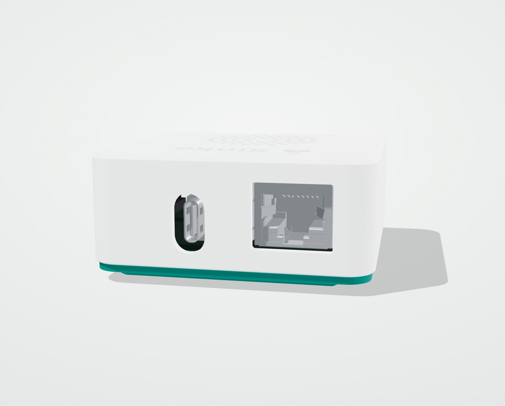
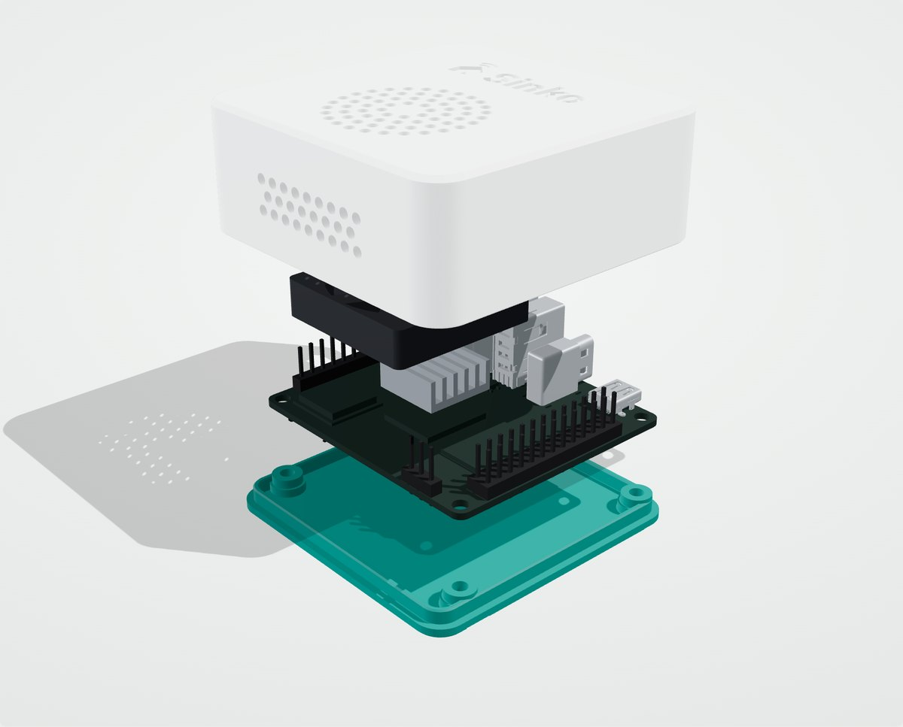

# Sinko box: a case for the Orange Pi Zero 3

<p align="center"></p>

A two-piece, fan-cooled case for the Orange Pi Zero 3 that runs Sinko. It is free to print, change and share
([licence](#licence)).

- **Closed.** Only USB-C (power) and Ethernet are open, at the back. Micro-HDMI, USB-A, the microSD slot and the pin
  headers stay inside, and the top is closed.
- **Quiet.** A 30 mm fan clips into the lid under a round grille and blows onto a small heatsink on the processor. Warm air
  leaves through the small holes in the front.
- **Two colours.** A white lid on a thin teal base, set back slightly so the box looks like it floats. The Sinko logo
  is engraved 0.6 mm into the top.
- **Size:** 60.6 × 60.6 × 25.8 mm, plus the rubber feet.

The case was drawn around Orange Pi's own 3D model of the board and checked against every part on it: nothing touches,
there is 1.7 mm of air between the fan and the heatsink, and the lid slides over the base with 0.2 mm to spare.

| Ports at the back | Inside |
|---|---|
|  |  |

## Get it printed

- **Order it on PCBWay:** the case is shared there, ready to order:
  [Sinko box on PCBWay](https://www.pcbway.com/project/shareproject/Sinko_box_a_minimal_fan_cooled_case_for_the_Orange_Pi_Zero_3_508ebe8e.html#cnclink).
- **Or print it yourself** from the files in [`print/`](print). They are already the right way up: the lid top face
  down, the base flat. Hand [`Sinko-case_PRINT-SPEC.pdf`](Sinko-case_PRINT-SPEC.pdf) to a print shop; it has the settings
  and what must not change.

| File | What it is |
|---|---|
| `print/Sinko-case_LID.stl` (and `.step`) | The lid, with the Sinko logo engraved |
| `print/Sinko-case_BASE.stl` (and `.step`) | The base |
| `print/Sinko-case_LID_no-logo.stl` (and `.step`) | The lid without the logo, for a case you changed or sell (see [licence](#licence)) |
| `print/optional/Sinko-case_LID_logo-inlay_OPTIONAL.stl` | Only for a multi-colour printer: load it with the lid at the same origin and the logo prints flush in the base colour |

**Settings:** PETG or ASA (not PLA: the box runs warm next to the processor), 0.16–0.20 mm layers, 3 walls, 20 % infill,
no supports. A textured bed gives the top a fine matte finish. Keep the scale at 100 % and do not resize the holes: the
four screw holes in the lid posts are 2.2 mm so that M2.5 screws cut their own thread.

## Parts

For one box:

| Part | Where we bought it |
|---|---|
| 30 × 30 × 7 mm 5 V fan, 2 wires with header plugs | [Easycargo 30 mm fan, AliExpress](https://www.aliexpress.com/item/1005009502512886.html) (two in a pack) |
| 14 × 14 mm heatsink, **6 mm tall at most**, with thermal tape | [14 × 14 × 6 mm aluminium heatsink, AliExpress](https://www.aliexpress.com/item/1005003219509348.html) (20 in a pack) |
| 4 × M2.5 × 10 mm screws, head no wider than 4.8 mm | [Socket-head screws, AliExpress](https://www.aliexpress.com/item/1005006968072651.html) (choose *M2.5x10*) |
| 4 × self-adhesive rubber feet, 10 mm across | Any |

The fan must be **7 mm** thick: a 6 mm fan rattles and a 10 mm fan hits the heatsink. The common 14 × 14 × 8 mm heatsinks
are too tall.

## Putting it together

1. Stick the heatsink on the processor, the large square chip in the middle of the board.
2. Press the fan into the lid, label side down, until the four clips click.
3. Plug the fan into pin 4 (5 V) and pin 6 (GND) of the 26-pin header. For a quieter fan, use pin 1 (3.3 V) and pin 9
   (GND) instead, if your fan is made for 3.3 V.
4. Set the board on the base's four posts, with the ports toward the back.
5. Lower the lid straight down. Its four posts land on the board's corner holes.
6. Turn the box over and drive the four screws up through the base until they are snug. Do not force them.
7. Stick the rubber feet into the four round recesses. They cover the screws.

The microSD card is inside. To change it, peel off the feet and take out the four screws.

## Change the design

The case is made in [CadQuery](https://cadquery.readthedocs.io) and every size is a named value at the top of
[`source/sinko_case.py`](source/sinko_case.py). To rebuild the files:

```bash
pip install cadquery shapely svgelements
python3 hardware/case/source/sinko_case.py      # writes hardware/case/source/build/
```

The logo is read from [`docs/img`](../../docs/img), so the engraving always matches the project's mark.

## Licence

The case design (the files in this folder) is under
[Creative Commons Attribution-ShareAlike 4.0](https://creativecommons.org/licenses/by-sa/4.0/) (CC BY-SA 4.0): print it,
change it and share it, give credit to the Sinko project, and share your changes under the same licence.

The Sinko name and logo, including the logo engraved on the lid, are the project's marks and are not covered by that
licence ([`TRADEMARK.md`](../../TRADEMARK.md)). Printing the case for your own Sinko box, or for family and friends, is
fine. If you change the case, or sell cases or boxes, use `Sinko-case_LID_no-logo` and follow the trademark policy.

---

<div dir="rtl" lang="ar">

## بالعربية

علبة من قطعتين لصندوق سينكو على لوحة Orange Pi Zero 3، مع مروحة هادئة. التصميم مجاني: اطبعه وعدّله وشاركه.

- **مغلقة:** المفتوح فقط منفذ USB-C للكهرباء ومنفذ الإنترنت (Ethernet) في الخلف. باقي المنافذ وبطاقة الذاكرة داخل العلبة.
- **هادئة:** مروحة 30 ملم تحت الشبكة الدائرية في الغطاء تبرّد المعالج، ويخرج الهواء من الثقوب الصغيرة في الأمام.
- **المقاس:** 60.6 × 60.6 × 25.8 ملم.

**للطباعة:** اطلبها جاهزة من
[PCBWay](https://www.pcbway.com/project/shareproject/Sinko_box_a_minimal_fan_cooled_case_for_the_Orange_Pi_Zero_3_508ebe8e.html#cnclink)،
أو اطبعها بنفسك من ملفات المجلد `print/` بخامة PETG أو ASA (وليس PLA)، بدون دعامات وبمقياس 100 %.

**القطع لكل صندوق:**
- مروحة 30 × 30 × 7 ملم بجهد 5 فولت: [AliExpress](https://www.aliexpress.com/item/1005009502512886.html)
- مشتت حراري 14 × 14 ملم بارتفاع 6 ملم كحد أقصى: [AliExpress](https://www.aliexpress.com/item/1005003219509348.html)
- أربعة براغي M2.5 × 10 ملم: [AliExpress](https://www.aliexpress.com/item/1005006968072651.html)
- أربع أرجل مطاطية لاصقة بقطر 10 ملم

**التجميع:** ألصق المشتت على المعالج، ثبّت المروحة في الغطاء حتى تسمع صوت المشابك، وصّلها بالدبوس 4 (5 فولت) والدبوس 6
(أرضي)، ضع اللوحة على قواعد القاعدة والمنافذ للخلف، أنزل الغطاء، ثم اربط البراغي الأربعة من الأسفل والصق الأرجل فوقها.

**الرخصة:** التصميم برخصة CC BY-SA 4.0. اسم سينكو وشعاره علامتان للمشروع: إذا عدّلت العلبة أو بعتها فاستخدم الغطاء
بدون شعار (`Sinko-case_LID_no-logo`).

</div>
